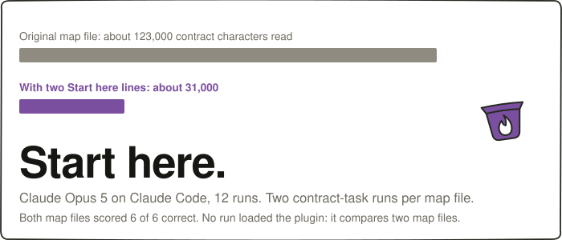

<div align="center">
  <picture>
    <source media="(prefers-color-scheme: dark)" srcset="assets/banner-dark.png" />
    
  </picture>
  <h1>Anneal</h1>
  <p><strong>Help coding agents find their way around an existing project.</strong></p>
</div>

<p align="center"><strong>Available on</strong></p>
<table align="center">
  <tr>
    <td align="center"><a href="#claude-code"><br />Claude Code, primary host</a></td>
    <td align="center"><a href="#codex"><br />Codex</a></td>
    <td align="center"><a href="#antigravity"><br />Antigravity</a></td>
  </tr>
</table>

<p align="center"><a href="#install"><strong>Get started</strong></a> · <a href="#what-is-this">What is this?</a> · <a href="#how-it-works">How it works</a> · <a href="#what-you-can-do">What you can do</a> · <a href="#the-numbers">Evidence</a></p>

## What is this?

Anneal is a plugin for Claude Code, an AI coding assistant. It also runs on Codex and Antigravity, two other coding assistants. It makes a project easier to navigate.

Three folders each have a discount function, and nothing says which one checkout uses. The assistant reads two wrong ones first.

Anneal finds what makes the assistant search or guess more than it needs to.

<p align="center"></p>

*Ember is the mascot of the Foundry plugins. The scene is an illustration, not a measurement.*

**You ask:** "What makes this project hard to navigate? Change nothing."

**You get:** a list of what slows the assistant down, with counts and example paths. No file changes. An illustration; the [recorded demo](#the-numbers) replays a real one.

## Why you'd want it

- **A map, not a search.** A short file says where things are.
- **Fewer repeated steps.** A step sessions keep repeating becomes one command.
- **Docs that match the code.** Anneal reports where they disagree.
- **Your yes comes first.** Nothing changes without it.

## How it works

1. A script reads your project, or the saved record of a past session. It uses no AI model.
2. Anneal reports what it found.
3. You approve each change, or none.

Anneal adds four skills, which are commands:

| Skill | What it does | Changes files? |
| --- | --- | --- |
| `overview` | Says what anneal finds here and which skill to run next | Never |
| `repo-layout` | Audits layout, or plans a migration | Only steps you approve |
| `session-review` | Reviews one session, or finds steps many sessions repeat | Only changes you choose |
| `repo-docs` | Reports where documentation disagrees with behavior | Only with `fix` or a cleanup request |

[How Anneal works](docs/knowledge/how-it-works.md) lists every finding, option and hook.

## What you can do

The table shows Claude Code's form. A skill's name differs by host:

| Claude Code | Codex | Antigravity |
| --- | --- | --- |
| `/anneal:overview` | `$overview` | `/overview` |

| You want to | What to type |
| --- | --- |
| See what Anneal finds and which skill to run next | `/anneal:overview` |
| Audit without edits | `/anneal:repo-layout audit` |
| Plan a migration and approve each step | `/anneal:repo-layout` |
| Propose instruction changes from one session | `/anneal:session-review [transcript file]` |
| Check whether deleting a finished session would lose work | `/anneal:session-review closeout <session id or transcript file>` |
| Find what many sessions repeat | `/anneal:session-review all [sessions folder or transcript files]` |
| Report where documentation disagrees with current behavior | `/anneal:repo-docs` |
| Apply fixes, trim, adopt a policy, or work on one README | `/anneal:repo-docs [fix\|maintain\|adopt\|readme] [path or concern]` |

To scan from the plugin folder yourself; the second form adds evidence:

```shell
node scripts/audit.js --root "<your-repository>"
node scripts/audit.js --root "<your-repository>" --json
```

### Settings

| Setting | Values | What it does |
| --- | --- | --- |
| `ANNEAL_SESSION_REPORT` | `off`, `0` or `false` | Turns off the line Anneal prints when a session starts. Any other value leaves it on. |
| Where to set it | The `env` block of Claude Code's `settings.json`, or the shell that starts the host | A running host does not pick up a new shell. |
| `CLAUDE_CONFIG_DIR`, `CODEX_HOME` | A folder; defaults `~/.claude` and `~/.codex` | Not Anneal settings. Anneal reads them as the host sets them, to find global files, memory and saved sessions. |
| `CLAUDE_PROJECT_DIR` | A folder; default the working folder, or the top of its Git tree | Not an Anneal setting. It is the project the session-start line reads. |

[Script options](docs/knowledge/how-it-works.md#script-options) lists each script's flags.

## Install

Every host needs Node.js 22 or later; confirm `node --version`. A migration, which moves files, also needs a commit, a clean tree and `git config user.email`. An audit does not.

### Claude Code

You need Claude Code 2.1.323 or later, and Git.

Inside Claude Code, run:

```text
/plugin marketplace add V-Songbird/foundry
/plugin install anneal@foundry
```

Then start a new session.

To check that it worked, run `claude plugin list` in a terminal. The list names `anneal`.

### Codex

You need a Codex host with plugin support, and Git.

In a terminal, run:

```text
codex plugin marketplace add V-Songbird/foundry
codex plugin add anneal@foundry
```

In `/hooks`, trust the `SessionStart` hook and the two `PreToolUse` hooks. A hook is a program the host runs, and [Codex hook trust](https://learn.chatgpt.com/docs/hooks#review-and-trust-hooks) says a changed one needs another review. Then start a new session.

To check that it worked, run `codex plugin list --marketplace foundry` in a terminal. The list names `anneal`.

### Antigravity

You need the Antigravity CLI, and Git. It has no marketplace for third-party plugins, so you install from a copy of the Foundry repository. Replace `<path-to-clone>` with a folder of your choice.

In a terminal, run:

```shell
git clone --recurse-submodules https://github.com/V-Songbird/foundry.git <path-to-clone>
agy plugin install <path-to-clone>/anneal
agy plugin list
```

Then start a new conversation. The list names `anneal` when it worked.

### Update

In Claude Code, run these. Then start a new session:

```text
/plugin marketplace update foundry
/plugin update anneal@foundry
```

In Codex, run these. Then start a new session. A changed hook stays off until you trust it again in `/hooks`:

```text
codex plugin marketplace upgrade
codex plugin remove anneal@foundry
codex plugin add anneal@foundry
```

In Antigravity, run these. Then start a new conversation:

```shell
git -C <path-to-clone> pull
git -C <path-to-clone> submodule update --init
agy plugin install <path-to-clone>/anneal
```

## Good to know

> **Experimental.** No support or stability promise. It can change or disappear without a migration path.

| Limit | What it means for you |
| --- | --- |
| Findings are estimates | Framework conventions and your project's instructions take precedence. |
| A map is matched by its paths | Anneal does not read what the map's sentences mean. |
| Import rewriting is partial | It covers relative imports and `require()` in JavaScript and TypeScript. Other languages, aliases and documents need review. Names built at runtime are never rewritten. |
| A session review reads one session | Its causes rest on names, paths and order. |
| The many-sessions pass matches text | It has run only in test cases. On Antigravity it reads only files you hand it. |
| The overview is untested live | It has not run live on any host. |
| The unused-tools report reads Claude Code only | That a setting removes a tool definition was read in one Claude Code release, not measured. It counts characters, not tokens. |
| Saved-session formats can change | A host format change can break the reading. Close-out reads Claude Code sessions only. |
| Redaction is best effort | The session file path is copied unredacted. |
| Documentation checks are limited | They do not prove every claim safe, and they do not scan Git history. |
| Some paths are unverified | A migration that moves files is unverified on Codex. The instruction guard's live refusal is unverified on every host. |
| A sandbox can hide an ignore file | The audit names it in a `limitation:` line. With `--sandbox`, headless `agy` runs no shell command. |

[Anneal limits](docs/knowledge/limits.md) states each one in full.

## The numbers

Each figure comes from recorded test sessions. The figures describe those runs, not yours, and results vary between runs.

### Claude Code results

This table compares two map files, with no plugin loaded in any session.

<!-- foundry:evidence {"platform":"Claude","status":"measured","models":["Claude Opus 5"],"source":"docs/knowledge/benchmarks.md","date":"unknown","dateReason":"The run date is not recorded.","revision":"not recorded","revisionReason":"The commit the run used is not recorded.","reviewedAt":"2026-11-16"} -->
| Model | Map file | Correct runs | Contract characters read | Contract task cost |
| --- | --- | --- | --- | --- |
| Claude Opus 5 | Original | 6/6 | About 123,000 | $1.10 |
| Claude Opus 5 | With two `Start here` lines | 6/6 | About 31,000 | $0.68 |

<p align="center"></p>

The runs with the lines took 58 seconds against 45. The run date is not recorded. Two runs each way cannot show a small effect.

Another batch tested the plugin: 2026-11-09, Claude Agent SDK, `claude-opus-5-5`, 15 cases, three runs each way.

With Anneal, 13 of 15 cases passed every check in all three runs. These runs are exploratory.

**Where Anneal lost.**

| Loss | What happened |
| --- | --- |
| A help-page review | One check passed 1 of 3 times with the plugin and 3 of 3 without. |
| A migration case | It stopped in every run with the plugin, for lack of a Git identity. |
| One migration step | It cost $0.58 and 66 seconds with Anneal, against $0.27 and 22 seconds without. It ran once each on Claude Opus 5, and its date was not recorded. |

<details>
<summary>Watch the recorded demo: one audit that changes no file, on Claude Opus 5.5</summary>

<p align="center"></p>

It ran 2026-11-16, took 20 seconds and passed 8 of 8 checks.

</details>

[Anneal benchmarks](docs/knowledge/benchmarks.md) has every batch.

### Codex results

<!-- foundry:evidence {"platform":"Codex","status":"pending","reason":"No Codex performance measurements are available."} -->
| Model | Setup | Correct runs | Contract characters read |
| --- | --- | --- | --- |
| Not measured | Not measured | Not measured | Not measured |

No Codex session has been measured yet.

### Antigravity results

<!-- foundry:evidence {"platform":"Antigravity","status":"pending","reason":"No Antigravity performance measurements are available."} -->
| Model | Setup | Correct runs | Contract characters read |
| --- | --- | --- | --- |
| Not measured | Not measured | Not measured | Not measured |

No Antigravity session has been measured yet.

## Going deeper

[How Anneal works](docs/knowledge/how-it-works.md) · [Anneal limits](docs/knowledge/limits.md) · [Anneal benchmarks](docs/knowledge/benchmarks.md)

Release notes are on the [Anneal releases page](https://github.com/V-Songbird/anneal/releases). [Foundry](https://github.com/V-Songbird/foundry) lists the whole family.

Report a bug or ask a question on [Anneal's issue tracker](https://github.com/V-Songbird/anneal/issues). Report a vulnerability as [SECURITY.md](SECURITY.md) says. To change Anneal, read [CONTRIBUTING.md](CONTRIBUTING.md).

## License

MIT, see [LICENSE](LICENSE).
