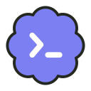

<div align="center">
  <picture>
    <source media="(prefers-color-scheme: dark)" srcset="assets/banner-dark.png" />
    
  </picture>
  <h1>anneal</h1>
  <p><strong>Help coding agents find their way around an existing project.</strong></p>
</div>

<p align="center"><strong>Available on</strong></p>
<table align="center">
  <tr>
    <td align="center"><a href="#codex"><br />Codex</a></td>
    <td align="center"><a href="#claude-code"><br />Claude Code</a></td>
    <td align="center"><a href="#antigravity"><br />Antigravity</a></td>
  </tr>
</table>

<p align="center"><a href="#install"><strong>Get started</strong></a> · <a href="#what-is-this">What is this?</a> · <a href="#how-it-works">How it works</a> · <a href="#what-you-can-do">What you can do</a> · <a href="#the-numbers">Evidence</a></p>

## What is this?

An agent opens your project to change how a discount is computed. Three packages have a discount function, nothing says which one the checkout uses, and the agent reads two wrong ones first. The next session does the same. This example illustrates the problem; the measurements below describe specific recorded runs.

anneal looks for what makes an agent search, read or guess more than it needs to. It audits the project's layout, reviews session detours, finds steps sessions repeat that a plain script could run, and aligns documentation with current behavior. It has three skills for those tasks and a fourth that says which to run.

Use it on an existing project. A single rename or a new scaffold needs none of it.

## Why you'd want it

- See what slows an agent down in your project, with counts and example paths.
- Give each session a short map instead of a search.
- Turn a step sessions keep repeating into one command.
- Keep documentation and agent instructions in line with what the code does.
- Change nothing without your approval.

## How it works

Each skill runs a script that reads your repository or a session transcript, then reports what it found. A change is proposed and waits for your yes. A migration works on its own `anneal/<YYYY-MM-DD>` branch, and each successful step is checked and committed there.

anneal also installs three hooks:

- **[Safety hook](docs/knowledge/workflows.md#the-safety-hook).** On a migration branch it refuses the git commands that would discard or rewrite the migration's work. On any other branch it asks before a command deletes, overwrites or moves a migration branch with commits of its own. Claude Code shows that question as a permission prompt, and Antigravity's documentation says it prompts too. On Codex, which does not support the question, the hook refuses the command. Neither was observed live.
- **[Instruction guard](docs/knowledge/workflows.md#the-instruction-guard).** It refuses a file-tool write that puts invisible characters into a file agents load as instructions, such as `AGENTS.md`. A live refusal is unverified on every host.
- **[Session-start line](docs/knowledge/workflows.md#the-session-start-line).** On Claude Code and Codex it names finished task notes still on disk and the record index. Whether a host passes that line to the agent is unverified.

## What you can do

These examples use Claude Code syntax. On Codex use `$<skill-name>`; on Antigravity use `/<skill-name>`.

| Task | Request |
| --- | --- |
| See what anneal finds and which skill to run next | `/anneal:overview` |
| Audit without edits | `/anneal:repo-layout audit` |
| Plan a migration and approve each step | `/anneal:repo-layout` |
| Propose instruction changes from one session | `/anneal:session-review [transcript file]` |
| Check whether deleting a finished session would lose work | `/anneal:session-review closeout <session id or transcript file>` |
| Find what many sessions repeat that a plain script or a map line could replace | `/anneal:session-review all [sessions folder or transcript files]` |
| Report where documentation disagrees with current behavior | `/anneal:repo-docs` |
| Apply those documentation fixes, trim, adopt a policy, or work on one README | `/anneal:repo-docs [fix\|maintain\|adopt\|readme] [path or concern]` |

No command edits your project on its own word. Each one reports, or proposes and waits for your approval, unless you type the word that applies: `fix` for documentation.

### Start with the overview

Ask for the overview, as your host invokes it:

| Host | Request |
| --- | --- |
| Codex | `$overview` |
| Claude Code | `/anneal:overview` |
| Antigravity | `/overview` |

It runs one read-only script with no model. For navigation, documentation and past sessions, it prints what anneal counted in your repository and which skill to run next.

### Audit the layout

Ask for an audit, such as `/anneal:repo-layout audit`. The skill runs the scan and reports findings by severity, with counts and example paths, followed by observations that carry no severity. Audit mode changes nothing on its own; it saves its findings only after you say yes.

From a clone of this repository, you can also run the scan directly. Replace `<your-repository>` with the directory to inspect:

```shell
node scripts/audit.js --root "<your-repository>"
```

It prints the findings, discovered map files, available checks, and the characters each session loads before its first prompt. Add `--json` for the evidence behind each count.

### Migrate, review sessions, reconcile documentation

A migration runs baseline checks, proposes changes, and creates an `anneal/<YYYY-MM-DD>` branch for approved steps. Each successful step is checked and committed.

Session review proposes edits and waits for approval; it commits nothing. With `all`, it reads this project's past sessions. For each step they repeated, it proposes a command or a short no-model script and the map-file line that names it. For each navigation problem several sessions share, it proposes the change that fits it. It writes only what you approve.

`/anneal:repo-docs` alone, or with `audit`, reports findings without edits. It saves a report only after you say yes. With `fix`, or when you ask for a cleanup in your own words, it applies the ordinary corrections. Its `adopt` mode writes the project-local documentation rule and a map pointer, each after you approve it. For a public solo repository, it also writes ignore rules from a shipped template after you approve them. Its `readme` mode writes, reviews or repairs one README and runs a bundled checker on it. Asked to write or review a help page, guide, FAQ or changelog, it follows its writing reference. It reports what it could not check against the product.

The [workflow guide](docs/knowledge/workflows.md) covers every audit finding, approval boundary, map-file format, safety hook, and eval.

### Turn off the session-start line

anneal has no settings file: you choose a skill and its mode. To turn off the [session-start line](docs/knowledge/workflows.md#the-session-start-line), set `ANNEAL_SESSION_REPORT=off` in the `env` block of Claude Code's `settings.json` or in your shell.

## Install

anneal is one package for Codex, Claude Code and Antigravity. Install it in the one you use. Every host needs Node.js 22 or later; the scan runs on it, so confirm `node --version` reports 22 or later.

A migration also needs a Git repository with a commit, a clean working tree, and `git config user.email` set. Audit mode does not require these.

### Codex

Requirements: Node.js 22 or later, Git and a Codex host with plugin support.

```text
codex plugin marketplace add V-Songbird/foundry
codex plugin add anneal@foundry
```

Before guarded work, open `/hooks` in Codex CLI and review and trust the plugin's `SessionStart` hook and its two `PreToolUse` hooks. A changed hook definition or hook script needs another review; see [Codex hook trust](https://learn.chatgpt.com/docs/hooks#review-and-trust-hooks). Then start a new Codex session.

### Claude Code

Requirements: Node.js 22 or later, Git and Claude Code.

Inside Claude Code:

```text
/plugin marketplace add V-Songbird/foundry
/plugin install anneal@foundry
```

Start a new session to load it. In a terminal, `claude plugin list` names `anneal` once installed.

### Antigravity

Requirements: Node.js 22 or later, Git and the Antigravity CLI. Antigravity has no marketplace for third-party plugins, so install anneal from a clone of Foundry, which checks anneal out at the commit the Claude Code and Codex catalogs pin. Replace `<path-to-clone>` with the directory to clone into:

```shell
git clone --recurse-submodules https://github.com/V-Songbird/foundry.git <path-to-clone>
agy plugin install <path-to-clone>/anneal
agy plugin list
```

The list names `anneal`. If it does not, the install did not register: run the install command again with the clone path. Start a new conversation to load it. With `--sandbox`, headless `agy` runs no shell command.

The install is a copy, so it stays at that commit. To take a new release, update the clone, install again and start a new conversation:

```shell
git -C <path-to-clone> pull
git -C <path-to-clone> submodule update --init
agy plugin install <path-to-clone>/anneal
```

## Good to know

> **Experimental.** No support or stability promise. It can change or disappear without a migration path.

- Findings are heuristics; framework conventions and project instructions take precedence.
- Import rewriting covers relative imports in JavaScript and TypeScript family files (`.js`, `.ts`, `.vue`, `.svelte` and their variants). Other references need review.
- Session review reads one transcript. Redaction is best effort; inspect excerpts before sharing them.
- The many-sessions pass matches steps as text after normalization. It finds Claude Code and Codex sessions on its own; on Antigravity it reads only the files you hand it. It has run only in eval cases through the Agent SDK, not in an interactive session. The overview has not run live on any host.
- Transcript parsing depends on the formats covered by tests. Antigravity requires an explicit transcript file. The close-out check reads Claude Code transcripts only.
- Documentation checks cover the stated evidence and do not scan Git history by default.
- A complete migration, with the Git guard's refusal on its branch, has been observed in Claude Code, Codex CLI and the Antigravity IDE. On Codex it only changed the map file, so a migration that moves files is unverified there.
- The audits and session review have run in Claude Code and in headless Codex and Antigravity CLI sessions. In the Antigravity IDE, flows other than the repo-layout audit and a migration are unverified.
- These results come from runs on specific host versions, some with a script rather than a person answering the prompts. [Host coverage](docs/knowledge/workflows.md#host-coverage) lists each run.
- Installing from the Foundry marketplace has not been observed on any host.

Read the [full limits](docs/knowledge/workflows.md#limits) before migrating a shared repository.

## The numbers

Each result belongs to the named model and recorded run. Missing measurements remain marked as unmeasured. Every figure comes from the [workflow guide](docs/knowledge/workflows.md#running-the-evals).

### Codex results

<!-- foundry:evidence {"platform":"Codex","status":"pending","reason":"No Codex performance measurements are available."} -->
| Model | Setup | Correct runs | Contract characters read |
| --- | --- | --- | --- |
| Not measured | Not measured | Not measured | Not measured |

No Codex session has been measured yet.

### Claude Code results

The first two tables compare two map files, not sessions with and without anneal: no session in them loaded the plugin. They test the kind of `Start here` line that points an agent at the right package or contract section.

<!-- foundry:evidence {"platform":"Claude","status":"measured","models":["Claude Opus 5"],"source":"docs/knowledge/workflows.md","date":"unknown","dateReason":"The workflow guide does not state the run date.","revision":"not recorded","revisionReason":"The workflow guide does not state the commit the run used."} -->
| Model | Map file | Correct runs | Contract characters read | Contract task cost |
| --- | --- | --- | --- | --- |
| Claude Opus 5 | Original | 6/6 | About 123,000 | $1.10 |
| Claude Opus 5 | With two `Start here` lines | 6/6 | About 31,000 | $0.68 |

[Paired navigation runs](docs/knowledge/workflows.md#paired-navigation-runs): Claude Code 2.1.278 under WSL2 with `claude-opus-5[1m]`, twelve runs, three tasks by two map files by two fresh sessions. The arms did not differ in correctness. The characters and the list-price cost estimate cover the two runs of the contract task in each arm; the runs with the extra lines took 58 seconds against 45. In the package lookup, the original runs opened three decoy files and the runs with the lines opened one. Two runs per arm cannot tell a small effect from noise.

<!-- foundry:evidence {"platform":"Claude","status":"measured","models":["Claude Opus 5"],"source":"docs/knowledge/workflows.md","date":"unknown","dateReason":"The workflow guide does not state the run date.","revision":"not recorded","revisionReason":"The workflow guide does not state the commit the run used."} -->
| Model | Map file | Correct runs | Contract characters read | Contract task cost |
| --- | --- | --- | --- | --- |
| Claude Opus 5 | Original | 6/6 | About 123,000 | $1.18 |
| Claude Opus 5 | With two `Start here` lines | 6/6 | About 17,000 | $0.57 |

[Held-out checks](docs/knowledge/workflows.md#held-out-checks): the same protocol, host and model on a second repository with another layout and contract, twelve runs. The contract task took about 45 seconds in each arm. In the package lookup, one original run opened two decoy files; the runs with the lines opened none.

<!-- foundry:evidence {"platform":"Claude","status":"measured","models":["Claude Opus 5.5"],"source":"docs/knowledge/workflows.md","date":"2026-11-09","revision":"not recorded","revisionReason":"The workflow guide does not state the commit the run used."} -->
| Model | Case | Grader | With anneal | Without |
| --- | --- | --- | --- | --- |
| Claude Opus 5.5 | `session-audit-keeps-a-machine-fact-out` | `machine-fact-for-the-global-file` | 3/3 | 1/3 |
| Claude Opus 5.5 | `session-audit-suggests-check-writer-with-collet` | `check-writer-suggested` | 3/3 | 0/3 |
| Claude Opus 5.5 | `readme-repair-without-the-word` | `node-before-install` | 3/3 | 1/3 |
| Claude Opus 5.5 | `readme-repair-without-the-word` | `no-copy-prompt` | 3/3 | 2/3 |
| Claude Opus 5.5 | `readme-review-reports-without-changes` | `names-badge-order` | 3/3 | 1/3 |
| Claude Opus 5.5 | `writing-page-without-the-word` | `node-before-install` | 3/3 | 0/3 |
| Claude Opus 5.5 | `plan-flags-a-wrong-importer-count` | `stale-row-flagged` | 3/3 | 1/3 |
| Claude Opus 5.5 | `plan-flags-a-wrong-importer-count` | `stale-row-not-planned` | 3/3 | 0/3 |

[The first SDK baseline](docs/knowledge/workflows.md#the-first-sdk-baseline), on 2026-11-09: 15 cases, three runs with anneal and three without, on `claude-opus-5-5` through the Claude Agent SDK 0.3.299 rather than a Claude Code session. The table lists every outcome grader where the two arms differed, in six cases. With anneal, 13 of the 15 cases passed every grader in all three runs. Four cases passed their outcome graders in every run of both arms, so they show nothing for the plugin until they are hardened. Graders that read anneal's own evidence output fail without the plugin by construction and are left out. Three runs per arm are exploratory, not a stable estimate.

### Antigravity results

<!-- foundry:evidence {"platform":"Antigravity","status":"pending","reason":"No Antigravity performance measurements are available."} -->
| Model | Setup | Correct runs | Contract characters read |
| --- | --- | --- | --- |
| Not measured | Not measured | Not measured | Not measured |

No Antigravity session has been measured yet.

*Results can vary between runs.*

## Going deeper

[Workflow guide](docs/knowledge/workflows.md) · [Limits](docs/knowledge/workflows.md#limits) · [Host coverage](docs/knowledge/workflows.md#host-coverage) · [Running the evals](docs/knowledge/workflows.md#running-the-evals) · [Contributing](CONTRIBUTING.md) · [Security](SECURITY.md) · [Changelog](docs/knowledge/changelog.md)

[Foundry](https://github.com/V-Songbird/foundry) lists this plugin. Bugs and questions go to the [issue tracker](https://github.com/V-Songbird/anneal/issues).

## License

MIT — see [LICENSE](LICENSE).
