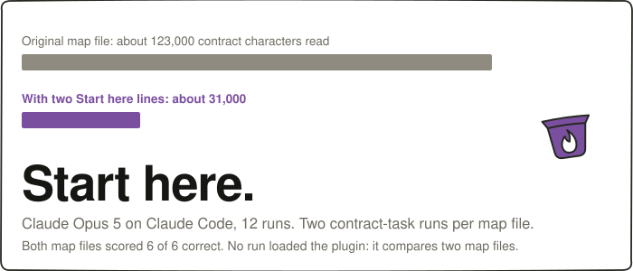

# Anneal benchmarks

This page holds every measurement Anneal publishes, with its model, sample size and limits. The README gives the map file result in prose, under [Does it work?](../../README.md#does-it-work).

Each result belongs to the named model and recorded run. Missing measurements remain marked as unmeasured. The raw records are kept outside this repository.

## Contents

- [Claude Code results](#claude-code-results)
- [Map file runs](#map-file-runs)
- [Held-out map file runs](#held-out-map-file-runs)
- [Three eval cases](#three-eval-cases)
- [One migration step](#one-migration-step)
- [SDK run, 2026-11-09](#sdk-run-2026-11-09)
- [Recorded demo, 2026-11-16](#recorded-demo-2026-11-16)
- [Losses](#losses)
- [Codex results](#codex-results)
- [Antigravity results](#antigravity-results)

## Claude Code results

The first two tables compare two map files, not sessions with and without anneal: no session in them loaded the plugin. They test a `Start here` line that points an agent at the right package or contract section.

## Map file runs

<!-- foundry:evidence {"platform":"Claude","status":"measured","models":["Claude Opus 5"],"source":"docs/knowledge/benchmarks.md","date":"unknown","dateReason":"The run date is not recorded.","revision":"not recorded","revisionReason":"The commit the run used is not recorded.","reviewedAt":"2026-11-16"} -->
| Model | Map file | Correct runs | Contract characters read | Contract task cost |
| --- | --- | --- | --- | --- |
| Claude Opus 5 | Original | 6/6 | About 123,000 | $1.10 |
| Claude Opus 5 | With two `Start here` lines | 6/6 | About 31,000 | $0.68 |

Paired navigation runs: Claude Code under WSL2 with `claude-opus-5[1m]`, twelve runs, three tasks by two map files by two fresh sessions. The arms did not differ in correctness. Characters and list-price cost cover the two contract-task runs per arm; those with the lines took 58 seconds against 45. In the package lookup the original runs opened three decoy files and the others one. In the control task, which needs no orientation, the lines cost 244 characters and the oriented runs used 8 tool calls against 11. Two runs per arm cannot tell a small effect from noise.

## Held-out map file runs

<!-- foundry:evidence {"platform":"Claude","status":"measured","models":["Claude Opus 5"],"source":"docs/knowledge/benchmarks.md","date":"unknown","dateReason":"The run date is not recorded.","revision":"not recorded","revisionReason":"The commit the run used is not recorded.","reviewedAt":"2026-11-16"} -->
| Model | Map file | Correct runs | Contract characters read | Contract task cost |
| --- | --- | --- | --- | --- |
| Claude Opus 5 | Original | 6/6 | About 123,000 | $1.18 |
| Claude Opus 5 | With two `Start here` lines | 6/6 | About 17,000 | $0.57 |

Held-out checks: the same protocol, host and model on a second repository with another layout and contract, twelve runs. The contract task took about 45 seconds in each arm. In the package lookup one original run opened two decoy files and the runs with the lines opened none. The lines cost 238 characters, and the oriented control runs used 8 tool calls against 10.

## Three eval cases

<!-- foundry:evidence {"platform":"Claude","status":"measured","models":["Claude Opus 5"],"source":"docs/knowledge/benchmarks.md","date":"unknown","dateReason":"The run date is not recorded.","revision":"not recorded","revisionReason":"The commit the run used is not recorded.","reviewedAt":"2026-11-16"} -->
| Model | Case | Score with Anneal | Score without |
| --- | --- | --- | --- |
| Claude Opus 5 | `audit-reports-without-changes` | 1.00 | 0.93 |
| Claude Opus 5 | `migration-stops-on-uncommitted-work` | 1.00 | 0.83 |
| Claude Opus 5 | `session-audit-proposes-without-writing` | 1.00 | 0.75 |

Three cases, three runs per arm, 18 sessions, on Claude Code with its default model `claude-opus-5`, about 13 minutes at a list-price estimate near $5. Plugin-dependent graders are indicators, left out of the score. Reply graders passed 17 of 18 times without the plugin. The session case's difference comes from one grader that passed in all three runs with the plugin and none without. Three runs per arm is a small sample.

## One migration step

One approved migration step on Claude Code under WSL2 with `claude-opus-5[1m]`, one run per arm, date not recorded: $0.58 and 66 seconds with Anneal, $0.27 and 22 seconds without.

## SDK run, 2026-11-09

<!-- foundry:evidence {"platform":"Claude","status":"measured","models":["Claude Opus 5.5"],"source":"docs/knowledge/benchmarks.md","date":"2026-11-09","revision":"not recorded","revisionReason":"The commit the run used is not recorded.","reviewedAt":"2026-11-16"} -->
| Model | Case | Grader | With Anneal | Without |
| --- | --- | --- | --- | --- |
| Claude Opus 5.5 | `session-audit-keeps-a-machine-fact-out` | `machine-fact-for-the-global-file` | 3/3 | 1/3 |
| Claude Opus 5.5 | `session-audit-suggests-check-writer-with-collet` | `check-writer-suggested` | 3/3 | 0/3 |
| Claude Opus 5.5 | `readme-repair-without-the-word` | `node-before-install` | 3/3 | 1/3 |
| Claude Opus 5.5 | `readme-repair-without-the-word` | `no-copy-prompt` | 3/3 | 2/3 |
| Claude Opus 5.5 | `readme-review-reports-without-changes` | `names-badge-order` | 3/3 | 1/3 |
| Claude Opus 5.5 | `writing-page-without-the-word` | `node-before-install` | 3/3 | 0/3 |
| Claude Opus 5.5 | `plan-flags-a-wrong-importer-count` | `stale-row-flagged` | 3/3 | 1/3 |
| Claude Opus 5.5 | `plan-flags-a-wrong-importer-count` | `stale-row-not-planned` | 3/3 | 0/3 |

The SDK run, on 2026-11-09: 15 cases, three runs with Anneal and three without, on `claude-opus-5-5` through the Claude Agent SDK rather than a Claude Code session, with judged graders on `claude-sonnet-5-5`. The table lists every outcome grader where the arms differed, in six cases. With Anneal, 13 of 15 cases passed every grader in all three runs. Four cases passed their outcome graders in every run of both arms, so they show nothing for the plugin until hardened. Graders that read Anneal's own evidence output fail without the plugin by construction and are left out. Three runs per arm are exploratory.

Two cases did not pass every grader with the plugin. A help-page review scored a reply grader 1 of 3 with the plugin and 3 of 3 without, though every run in both arms named both planted defects. A migration into a new directory stopped in every run with the plugin because the session had no Git identity. A second run of both migration cases on 2026-11-09, same runner and model, three runs per arm, cost an estimated $1.32: with the plugin every run created the branch, moved the file, rewrote both imports and committed; without it none created the branch or an `anneal:` commit.

## Recorded demo, 2026-11-16

Watch the recorded demo: one audit that changes no file, on Claude Opus 5.5

It ran 2026-11-16, took 20 seconds and passed 8 of 8 checks.

The demo is one recorded session on Claude Code with Claude Opus 5.5, on 2026-11-16. It is not a comparison and not a sample.

Method: the session was asked to list navigation problems. Anneal named three of six and changed no file. The run took 20 seconds and passed 8 of 8 checks.

Limits: one session cannot show how often Anneal finds the same three problems. The six problems are the ones in that repository, so the count does not carry to yours. The README does not state the plugin revision, the cost or the list of the 8 checks, so this page does not either.

## Losses

Every loss the page holds, in one place. Each is a small sample and describes one run, not yours.

- **Help-page review reply grader.** In the [SDK run](#sdk-run-2026-11-09), a reply grader passed 1 of 3 times with Anneal and 3 of 3 without. Every run in both arms named both planted defects.
- **Migration case with no Git identity.** In the same run, a migration into a new directory stopped in every run with the plugin, because the session had no Git identity.
- **Migration step cost.** In [One migration step](#one-migration-step), the step cost $0.58 and 66 seconds with Anneal, against $0.27 and 22 seconds without. One run per arm, date not recorded.

## Codex results

<!-- foundry:evidence {"platform":"Codex","status":"pending","reason":"No Codex performance measurements are available."} -->
| Model | Setup | Correct runs | Contract characters read |
| --- | --- | --- | --- |
| Not measured | Not measured | Not measured | Not measured |

No Codex session has been measured yet.

## Antigravity results

<!-- foundry:evidence {"platform":"Antigravity","status":"pending","reason":"No Antigravity performance measurements are available."} -->
| Model | Setup | Correct runs | Contract characters read |
| --- | --- | --- | --- |
| Not measured | Not measured | Not measured | Not measured |

No Antigravity session has been measured yet.
